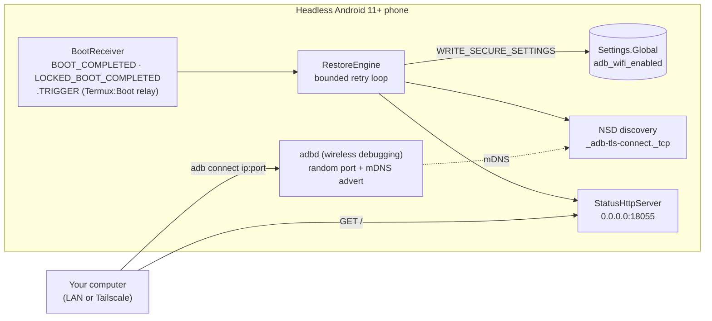
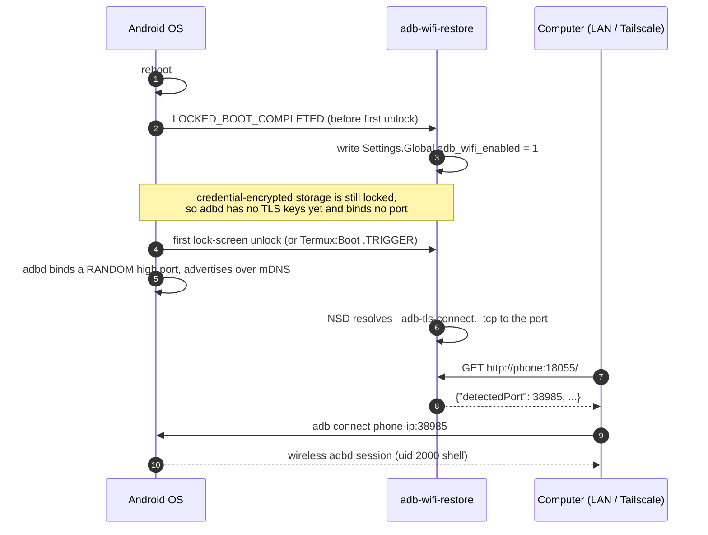

# adb-wifi-restore


[](https://github.com/jiaquanchou/adb-wifi-restore/actions/workflows/ci.yml)
[](https://github.com/jiaquanchou/adb-wifi-restore/releases)
[](LICENSE)


*[中文文档](README_zh.md)*

---

An old Android phone makes a wonderful headless Linux box (Termux, homelab
messenger, wire-free maintenance drone) — until it reboots. Then three things
happen at once:

1. **Wireless debugging turns itself off.** The system `adb_wifi_enabled`
   setting reverts to 0 on every boot.
2. **`adb tcpip 5555` silently dies too.** It only lives for the current boot.
3. Even if you turn wireless debugging back on, the OS assigns a **random
   high port**, and a non-root Termux user is not allowed to read it.

If the phone is on the other side of the country, that means it is gone until
somebody physically touches it. This tiny app (zero dependencies, ~100 KB)
fixes all three:

- it flips `adb_wifi_enabled` back to 1 right after boot,
- it catches the freshly assigned random port via mDNS (NSD),
- and it serves the port number over a plain HTTP endpoint, so any computer
  on your LAN / Tailscale can reconnect with one command.

No root required — just one `adb shell pm grant` from a computer, once.

## How it works



After a cold reboot:



## Quick start

Prerequisites: the phone runs Android 11+; your computer has `adb`; you have
**one** working adb connection to the phone (USB, or wireless debugging paired
manually just this once).

**1. Install and grant (one time):**

```bash
adb install adb-wifi-restore-1.0.0.apk
adb shell pm grant dev.adbwifi.restore android.permission.WRITE_SECURE_SETTINGS
adb shell dumpsys deviceidle whitelist +dev.adbwifi.restore
```

**2. Pair your computer once** (pairing survives reboots; only the port
changes): phone *Settings → Developer options → Wireless debugging → Pair
device with pairing code*, then from the computer:

```bash
adb pair <phone-ip>:<pairing-port>   # enter the 6-digit code when asked
```

**3. (Recommended) Termux:Boot relay** — a second trigger that fires ~60 s
after boot, after the storage is unlocked. Install the [Termux:Boot][tb] app,
create `~/.termux/boot/adb-restore.sh`:

```sh
#!/data/data/com.termux/files/usr/bin/sh
am broadcast -a dev.adbwifi.restore.TRIGGER >/dev/null 2>&1
```

and `chmod +x` it.

**4. Reboot and verify** from anywhere that can reach the phone:

```bash
curl http://<phone-ip>:18055/
# -> {"hasSecurePermission":true,"detectedPort":38985,"ips":[...],...}

adb connect <phone-ip>:38985
# or one shot:
./scripts/adb_connect.sh <phone-ip>
```

[tb]: https://github.com/termux/termux-boot (Termux:Boot on F-Droid / GitHub)

## Upgrading

Reinstalling over an existing installation (`adb install -r`) keeps the
permission grant, the pairing and the deviceidle whitelist. From your
computer, with the device reachable over adb (e.g. via
`scripts/adb_connect.sh`):

```bash
./scripts/adb_upgrade.sh <phone-ip>              # latest GitHub release APK
./scripts/adb_upgrade.sh <phone-ip> ./local.apk  # or a locally built APK
```

In-app self-update is deliberately not implemented: an Android app cannot
silently reinstall itself (PackageInstaller requires on-screen confirmation,
and a non-root Termux cannot run `pm install` — field-tested). The upgrade
automation therefore lives on the trusted computer side, where adb already
holds uid 2000.

## HTTP status API

`GET http://<phone>:18055/` (any path works):

| Field | Meaning |
|---|---|
| `hasSecurePermission` | `WRITE_SECURE_SETTINGS` granted via adb |
| `isWifiConnected` | Wi-Fi transport currently active |
| `currentSettingValue` | `adb_wifi_enabled` as the system sees it |
| `putSuccess` | result of the last restore write |
| `detectedPort` / `detectedHost` | wireless-debugging port caught by NSD |
| `ips` | device IPv4 addresses (Wi-Fi, Ethernet, Tailscale…) |
| `lastError` / `lastTrigger` / `lastUpdated` | what happened, when, why |

`GET /?trigger=1` additionally runs one restore attempt before answering —
handy when the port is missing.

## Pitfalls worth knowing (all field-tested)

**Direct Boot — the port only opens after the first unlock.** After a cold
reboot, credential-encrypted storage (where adbd keeps its TLS keys) stays
locked until the lock screen is unlocked once. The app already restores the
*setting* before that point, but the network port appears only after the first
unlock — unless no secure lock screen is set. This is an OS security design,
not a bug; plan your headless box accordingly.

**mDNS does not cross subnets — that is why the HTTP reporter exists.** From a
computer on another subnet or a Tailscale network, `adb mdns services` shows
nothing. The in-app reporter on port 18055 is the reliable discovery channel.

**Why not `adb tcpip 5555`?** Measured on a Redmi K30 5G (Android 12/MIUI 13):

| Approach | Works over Tailscale after unplugging USB | Survives unattended reboot |
|---|---|---|
| Wireless debugging (paired) | ✅ | ❌ switch off, random port |
| `adb tcpip 5555` | ✅ | ❌ `service.adb.tcp.port` empty, nothing listens |

**MIUI / HyperOS.** Enable *Autostart* for the app (and for Termux:Boot), set
battery saver to *No restrictions* for both, and keep the `deviceidle
whitelist` entry from step 1 — otherwise aggressive ROMs may swallow the boot
broadcast.

**Battery.** The app has no foreground service and no wakelocks; it only runs
briefly on boot and on trigger. It adds essentially zero drain.

**Privacy on a shared phone.** The self-heal path never opens any UI — the
status dashboard only appears when you tap the icon, auto-closes after 30 s of
inactivity (the background service keeps running), and is excluded from the
recents screen, so a phone left on a shelf does not sit on a page full of
IP addresses.

## Security notes

- `WRITE_SECURE_SETTINGS` is powerful. Grant it only to apps whose source you
  accept; this one is ~100 KB of Java with zero third-party dependencies, and
  you are invited to build it yourself.
- The HTTP reporter announces the current adb port to **anyone** who can reach
  the phone on that port. Keep the phone on a trusted LAN, or — better — behind
  Tailscale, where reaching the tailnet *is* the authentication.
- Release APKs are signed with a debug-style key unless the maintainer
  configures CI signing secrets. Download from the Releases page only, check
  the published `.sha256`, and prefer upgrading over reinstalling (signature
  consistency).

## Compatibility

Detailed device/capability matrix (Chinese): [docs/兼容性与测试矩阵.md](docs/兼容性与测试矩阵.md).

| Device | Android | ROM | Status |
|---|---|---|---|
| Redmi K30 5G | 12 | MIUI 13 | ✅ full loop verified: grant → reboot → auto-restore → port via NSD → `adb connect` over Tailscale |
| Huawei MatePad 11.5 (BTK-W00) | 12 | EMUI/HarmonyOS | ✅ setting self-heal verified live (0 → trigger → 1); ⚠️ two EMUI quirks below |

**EMUI / Huawei caveats** (field-measured): the wireless adbd binds to the
**Wi-Fi interface only** — connections to a Tailscale/VPN IP are refused, so
reach the device via its LAN IP (directly, or through a subnet route).
`NsdManager` may fail to resolve the random port (`detectedPort` stays -1);
discover it by scanning the device's high ports instead. And EMUI restricts
background broadcast starts — set the app's launch management to *manual* with
all three toggles on, and keep the Termux:Boot relay.

The mechanism (`adb_wifi_enabled` + `WRITE_SECURE_SETTINGS` + NSD) is stock
AOSP behaviour on Android 11+, so other ROMs are expected to work; reports
welcome.

## Building

Gradle (Android Studio or CLI, JDK 17+):

```bash
./gradlew assembleDebug
```

No Gradle around? The standalone chain needs only a JDK 11+ and any Android
SDK with a platform + build-tools (macOS / Linux):

```bash
ANDROID_SDK=/path/to/sdk ./scripts/build-standalone.sh
# -> build/adb-wifi-restore.apk
```

CI builds a debug APK on every push and attaches a signed release APK to
GitHub Releases on `v*` tags.

## FAQ

**Does it need root?** No. One `adb shell pm grant` from a computer is all the
elevation it ever needs; the grant survives until the app is uninstalled.

**Does pairing survive reboots?** Yes. Only the port changes, which is exactly
what the reporter tracks.

**Where is the port number coming from?** The system adbd publishes
`_adb-tls-connect._tcp` over mDNS whenever wireless debugging starts; the app
listens with `NsdManager` and resolves the port in milliseconds.

**My ROM killed the app after boot.** Do the MIUI/battery steps above; also
check that the app shows `lastTrigger` advancing in its status JSON.

**Can the reporter port change?** It is a constant (`StatusHttpServer.PORT`)
today; PRs to make it configurable are welcome.

## Roadmap

- [ ] configurable HTTP reporter port
- [ ] screenshots (light / dark)
- [ ] more ROM reports ( Samsung One UI, Pixel, HyperOS 14+ …)

## Contributing

See [CONTRIBUTING.md](CONTRIBUTING.md). The two hard project rules: **zero
runtime dependencies** and **tiny APK** — they are what keep the standalone
build chain and the security story honest.

## License

[Apache-2.0](LICENSE)
