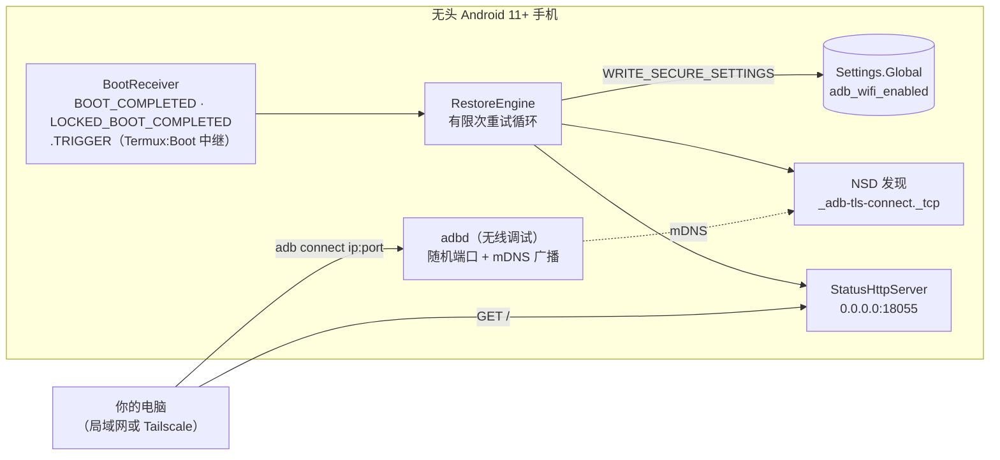
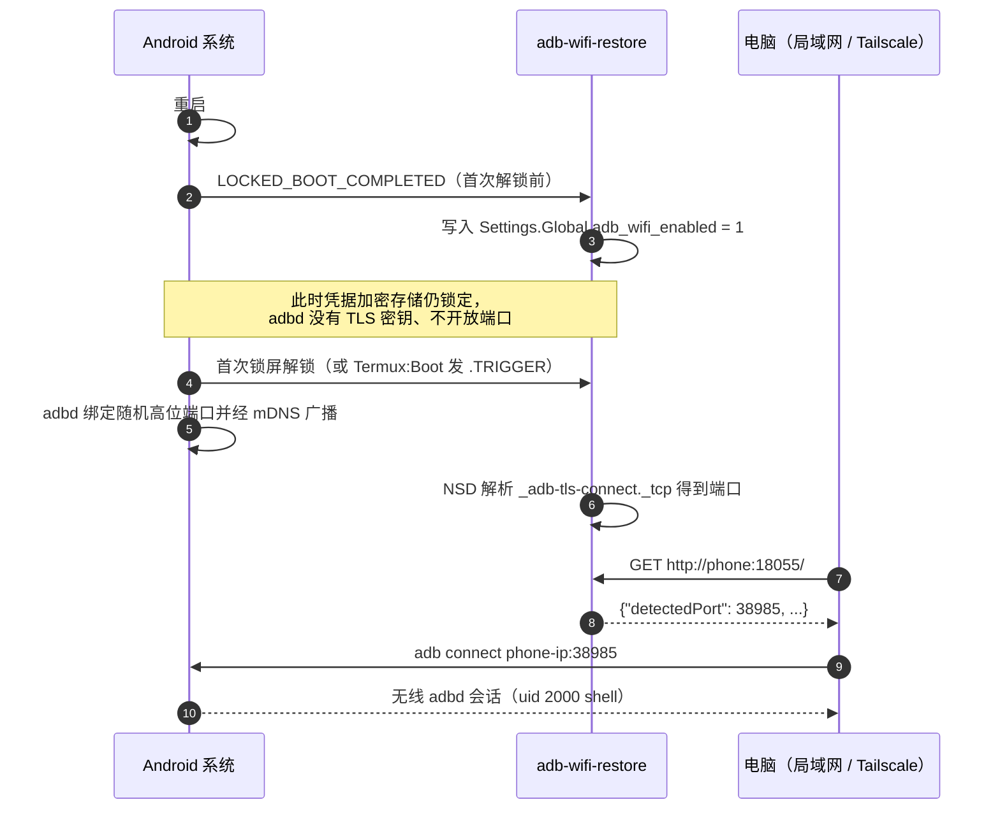

# adb-wifi-restore


[](https://github.com/jiaquanchou/adb-wifi-restore/actions/workflows/ci.yml)
[](https://github.com/jiaquanchou/adb-wifi-restore/releases)
[](LICENSE)


*[English](README.md)*

---

把闲置 Android 手机改造成无头 Linux 服务器（Termux、homelab 信使、免物理线运维）很香——直到它断电重启。重启瞬间三件事同时发生：

1. **「无线调试」开关自动回落为关闭**，系统的 `adb_wifi_enabled` 每次开机都归零；
2. **`adb tcpip 5555` 也一样静默失效**，只在当前开机周期有效；
3. 就算手动打开无线调试，系统分配的是**随机高位端口**，非 root 的 Termux 用户连读端口的权限都没有。

如果手机远在千里之外，就只能千里迢迢回去物理接触。这个小工具（零依赖，约 100 KB）把三件事全修了：

- 开机后立刻把 `adb_wifi_enabled` 写回 1；
- 用 NSD（mDNS）毫秒级捕获系统新分配的随机端口；
- 内置 HTTP 上报端口，局域网 / Tailscale 上的任意电脑一条命令即可重新连上。

无需 root——只需在电脑上 `adb shell pm grant` 一次。

## 工作原理



冷重启后的完整时序：



## 快速接入

前置条件：手机为 Android 11+；电脑装有 `adb`；当前有**一条**可用的 adb 通道（USB，或手动配对一次无线调试）。

**1. 安装并授权（仅一次）：**

```bash
adb install adb-wifi-restore-1.0.0.apk
adb shell pm grant dev.adbwifi.restore android.permission.WRITE_SECURE_SETTINGS
adb shell dumpsys deviceidle whitelist +dev.adbwifi.restore
```

**2. 电脑与手机配对一次**（配对记录重启不丢，会漂移的只有端口）：手机*设置 → 开发者选项 → 无线调试 → 使用配对码配对设备*，然后在电脑上：

```bash
adb pair <手机IP>:<配对端口>   # 按提示输入 6 位配对码
```

**3.（推荐）Termux:Boot 双保险** —— 开机约 60 秒后（存储已解锁）再触发一次。安装 [Termux:Boot][tb] 应用，创建 `~/.termux/boot/adb-restore.sh`：

```sh
#!/data/data/com.termux/files/usr/bin/sh
am broadcast -a dev.adbwifi.restore.TRIGGER >/dev/null 2>&1
```

并 `chmod +x`。

**4. 重启后异地验证：**

```bash
curl http://<手机IP>:18055/
# -> {"hasSecurePermission":true,"detectedPort":38985,"ips":[...],...}

adb connect <手机IP>:38985
# 或者一条龙：
./scripts/adb_connect.sh <手机IP>
```

[tb]: https://github.com/termux/termux-boot （Termux:Boot，F-Droid / GitHub 可装）

## 升级

在旧版本之上重装（`adb install -r`）会保留权限授予、配对记录和白名单。在电脑上执行（设备需已可通过 adb 连接，如先用 `scripts/adb_connect.sh`）：

```bash
./scripts/adb_upgrade.sh <手机IP>              # 自动下载最新 GitHub Release APK
./scripts/adb_upgrade.sh <手机IP> ./local.apk  # 或安装本地构建的 APK
```

**刻意不做 App 内自升级**：Android 应用无法静默重装自身（PackageInstaller 需要屏幕确认，非 root 的 Termux 也跑不了 `pm install`——均实测）。升级自动化因此放在可信的电脑侧——那里 adb 已经握着 uid 2000。

## HTTP 状态接口

`GET http://<手机>:18055/`（任意路径均可）：

| 字段 | 含义 |
|---|---|
| `hasSecurePermission` | `WRITE_SECURE_SETTINGS` 是否已经 adb 授权 |
| `isWifiConnected` | 当前是否有 Wi-Fi 传输 |
| `currentSettingValue` | 系统视角的 `adb_wifi_enabled` |
| `putSuccess` | 最近一次恢复写入的结果 |
| `detectedPort` / `detectedHost` | NSD 捕获的无线调试端口 |
| `ips` | 本机 IPv4 列表（Wi-Fi、以太网、Tailscale…） |
| `lastError` / `lastTrigger` / `lastUpdated` | 最近一次发生什么、被谁触发、何时 |

`GET /?trigger=1` 会在应答前先执行一次恢复——端口缺失时很有用。

## 核心避坑指南（全部实测）

**Direct Boot：首次解锁前端口不会开放。** 冷重启后，凭据加密存储（adbd 的 TLS 密钥所在）在锁屏完成首次解锁前保持锁定。App 在此之前就能把*开关*恢复，但网络端口要等首次解锁后才出现——除非设备未设安全锁屏。这是系统安全设计而非缺陷，请据此规划无头设备的运维窗口。

**mDNS 不跨网段——这正是 HTTP 上报存在的原因。** 跨网段或经 Tailscale 时，电脑上 `adb mdns services` 什么都看不到；App 内置的 18055 上报端口才是可靠的发现通道。

**为什么不用 `adb tcpip 5555`？** Redmi K30 5G（Android 12 / MIUI 13）实测：

| 方式 | 拔 USB 后经 Tailscale 可连 | 无人工重启后仍可用 |
|---|---|---|
| 无线调试（已配对） | ✅ | ❌ 开关归零 + 端口随机 |
| `adb tcpip 5555` | ✅ | ❌ `service.adb.tcp.port` 为空、无监听 |

**MIUI / HyperOS。** 给本 App（以及 Termux:Boot）开启*自启动*，省电策略设为*无限制*，并保留第 1 步的 `deviceidle whitelist`——否则激进的 ROM 可能把开机广播吞掉。

**耗电。** App 无前台服务、无 wakelock，只在开机和被触发时短暂运行，耗电几乎为零。

**共用设备的隐私。** 自愈链路从不打开任何界面——状态页只在你主动点图标时出现，闲置 30 秒自动关闭（后台服务继续运行），且不进入最近任务列表；手机放在架子上不会停在满是 IP 地址的页面上。

## 安全须知

- `WRITE_SECURE_SETTINGS` 权限很大，只授予你审过源码的应用。本应用约 100 KB 纯 Java、零第三方依赖，欢迎自行构建比对。
- HTTP 上报端口会向**所有**能访问该端口的设备暴露当前 adb 端口。请让手机只待在可信局域网，或更稳妥地放进 Tailscale——能进 tailnet 本身就是认证边界。
- Release APK 默认用调试风格密钥签名（除非维护者配置了 CI 签名 Secret）。请只从 Releases 页面下载、核对 `.sha256`，升级优先于卸载重装（保持签名一致）。

## 兼容性

| 设备 | Android | ROM | 状态 |
|---|---|---|---|
| Redmi K30 5G | 12 | MIUI 13 | ✅ 全链路实测：授权 → 重启 → 自动恢复 → NSD 抓端口 → Tailscale 上 `adb connect` 成功 |
| 华为 MatePad 11.5（BTK-W00） | 12 | EMUI/HarmonyOS | ✅ 开关自愈实测有效（0 → 触发 → 1）；⚠️ 两条 EMUI 特性见下 |

**EMUI / 华为实测避坑**：无线 adbd **只绑定 Wi-Fi 网卡**——连 Tailscale/VPN 地址会被拒，请走局域网 IP（直连或经子网路由）；`NsdManager` 可能解析不出随机端口（`detectedPort` 保持 -1），改用扫描设备高位端口的方式发现；且 EMUI 限制后台广播拉起进程——请把本 App 的「启动管理」改为手动并打开全部三个开关，并保留 Termux:Boot 双保险。

机制本身（`adb_wifi_enabled` + `WRITE_SECURE_SETTINGS` + NSD）是 Android 11+ 的 AOSP 原生行为，其他 ROM 预期可用，欢迎回报测试结果。

## 构建

Gradle（Android Studio 或命令行，JDK 17+）：

```bash
./gradlew assembleDebug
```

手边没有 Gradle？standalone 链路只需 JDK 11+ 和任一带 platform + build-tools 的 Android SDK（macOS / Linux 通用）：

```bash
ANDROID_SDK=/path/to/sdk ./scripts/build-standalone.sh
# -> build/adb-wifi-restore.apk
```

CI 在每次 push 时构建 debug APK，`v*` tag 会自动发布签名 APK 到 GitHub Releases。

## FAQ

**需要 root 吗？** 不需要。电脑上 `adb shell pm grant` 一次就是它需要的全部提权；授权在卸载前一直有效。

**配对记录重启会丢吗？** 不会，会变的只有端口——而这正是上报服务追踪的东西。

**端口从哪来的？** 系统无线调试每次启动都会经 mDNS 发布 `_adb-tls-connect._tcp`，App 用 `NsdManager` 监听并毫秒级解析端口。

**ROM 把 App 杀了怎么办？** 做完 MIUI/省电那几步，再看状态 JSON 里 `lastTrigger` 是否在推进。

**上报端口能换吗？** 目前是常量（`StatusHttpServer.PORT`），欢迎 PR 做成可配置。

## 路线图

- [ ] HTTP 上报端口可配置
- [ ] 界面截图（浅色 / 深色）
- [ ] 更多 ROM 实测报告（One UI、Pixel、HyperOS 14+…）

## 参与贡献

见 [CONTRIBUTING.md](CONTRIBUTING.md)。本项目的两条铁律：**零运行时依赖** 与 **APK 保持极小**——standalone 构建链和安全叙事都建立在它们之上。

## 开源协议

[Apache-2.0](LICENSE)
